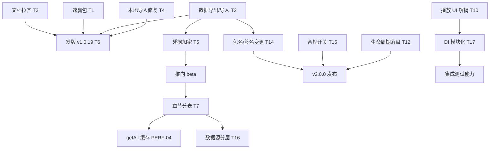

# 聆云（audiobook_app）优化方案与后续开发计划

> 代码基线：pubspec `1.0.18+19`｜Flutter 工程：`D:\Project\TraeWorkspace\audiobook\audiobook_app_src`
> 制定日期：2026-09-23
> 前提约束：**不推翻现有 Flutter + Provider + Hive 的整体架构**，全部以增量方式落地；每个版本独立可发布，不设"停服维护窗口"。

## 0. TL;DR 与实施原则

三条主线的现状一句话总结：

| 线 | 现状 | 本方案的核心动作 |
|---|---|---|
| 工程完整性 | 功能完成度高，但**发布链路与文档已脱节**：源码 1.0.18，对外 APK 只有 v1.0.9/v1.0.10，README 版本号还停留在 1.0.9 | 先发一个"真实反映当前代码"的 v1.0.19 止血包 |
| 存量缺陷 | 本地导入 **100% 播不出声**、Hive 失败静默丢数据、异步崩溃不可观测、网盘凭据**明文落盘** | 归入 P0，优先于任何新功能 |
| 性能与结构 | 章节列表内嵌单条 Hive 记录导致写放大；services 反向依赖 pages；无生命周期兜底 flush | P1/P2，随版本穿插，不阻塞发版 |

**实施原则**：① 数据迁移一律采用"惰性 + 旧字段保留"双读模式，保证任何时刻可回滚；② 破坏性变更（包名/签名）必须与"数据导出"能力捆绑上线；③ 每条优化自带可判定的验收口径，拒绝"感觉快了"。

---

## 1. 优化点清单（按优先级）

优先级判定口径 = **影响面 ÷ 投入成本**。影响面：高＝影响线上可用性或数据安全；中＝影响体验或迭代速度；低＝卫生问题。

### 1.1 速赢包（约 1.9 人日，建议本周单独发版）

这些项改动都在个位数文件、几乎无回归风险，但收益极高。

| 编号 | 维度 | 现状证据 | 优化动作 | 目标与预期收益 | 成本 |
|---|---|---|---|---|---|
| STAB-02 | 稳定性 | `main.dart:30-35` 只挂了 `FlutterError.onError` | 补 `PlatformDispatcher.instance.onError` + `runZonedGuarded`，统一走 `_reportError()` | 网盘解析/Hive 读写里的异步异常不再静默消失；release 包 Crash 可观测 | 0.3 |
| STAB-04 | 稳定性 | `quark_drive_service.dart:51-58` 放行 4xx；`baidu_drive_service.dart:38-42` 未设 `validateStatus` 导致 4xx 抛异常、拿不到百度错误体；`book_source_engine.dart:59-69` 无下界 | 新建 `services/http/dio_factory.dart` 统一 `connectTimeout 15s / receiveTimeout 20s / validateStatus 200≤s<600`，三处改用同一工厂 | 百度 token 失效/分享过期时能读 `error_msg` 给出准确提示，而不是笼统"网络错误" | 0.5 |
| STAB-06 | 稳定性 | `baidu_drive_service.dart:141-155 setCookie` 直接落盘、无校验（对比 quark / baidu token 均有校验） | 对齐 quark 写法：先调 `xpan/nas?method=uinfo` 验证，通过才 `saveBaiduCookie` | 消除"粘了过期 Cookie→显示已登录→所有解析 401"的假登录态 | 0.3 |
| MAINT-02 | 可维护性 | `pubspec.yaml:36,39,45`：`go_router`、`intl`、`crypto` 全库 0 引用 | 删除三行（`encrypt` 的去留随 SEC-01 方案决定） | 依赖树与包体减小，消除"声明了加密库却没用"的安全错觉 | 0.2 |
| MAINT-03 | 可维护性 | `widgets/mini_player.dart`、`book_card.dart` 无任何 import | 删除（删前确认产品不再复活旧迷你条，注意 `mini_player.dart:35` 曾是悬浮球前身） | 减少 ~8KB 维护面与 analyze 噪声 | 0.2 |
| MAINT-04 | 可维护性 | `tool/` 常驻 11MB（其中 10.6MB 已被 ignore 但仍占工作区），`tool/online_source_probe.dart` 未提交 | 物理删除 `out_*.json`/`s*.html`/空 `probe/`；探针脚本归档到 `research/`；根目录 6 个 html + 9 张 png 移 `docs/prototype/` | 工作区 11MB → <1MB；换机 clone 不再丢失原型文件 | 0.3 |
| MAINT-07 | 可维护性 | `pubspec.yaml:51 permission_handler: 11.3.1` 精确锁版且无注释（相邻的 inappwebview 有 3 行原因注释，做法不一致） | 补齐锁定原因注释与"解除条件" | 半年后接手者知道为何不能升、何时能升 | 0.1 |

### 1.2 P0（必须做，合计 ≈ 9.5 人日）

| 编号 | 维度 | 现状证据 | 优化动作 | 目标与预期收益 | 影响面 | 成本 | 依赖 |
|---|---|---|---|---|---|---|---|
| SEC-01 | **安全性** | `storage_service.dart:57-91` 把 `quark_cookie`/`baidu_token`/`baidu_cookie`/`baidu_app_key` **明文**写 Hive `app_config`；`encrypt`/`crypto` 声明但 0 import | ① 新增 `services/secure_storage.dart`：`flutter_secure_storage` 存随机 32B 主密钥；② `app_config` 用 `HiveAesCipher` 打开；③ 惰性迁移（见 §风险 R1） | `adb backup`/root 导出能直接接管用户网盘的凭据不再可读。**降级方案**：本期只加密 `app_config`（~10 个 key，毫秒级），成本降至 1.5 | 高 | 2.5 | 无 |
| STAB-05 | **稳定性** | `local_import_service.dart:22-23,35` 存裸路径；播放器 `audio_player_service.dart:631` 用 `Uri.parse()` 得到无 scheme 的 URI → **本地导入的书 100% 播不出声**；`:16-18` 只能单文件 | ① 播放器改 `Uri.file(chapter.filename)`（**无需迁移旧数据**）；② `pickFiles(allowMultiple:true)` + 复用 `drive_item.dart` 的 `compareNatural` 自然排序生成多章节 | 本地导入从完全不可用变为可用；50 章的书从 50 次选择变 1 次 | 高 | 1.2 | 无 |
| PERF-01 | 性能 | `bookshelf_book.dart:63` chapters 内嵌单条 value；`bookshelf_repository.dart:39-42` 每次 add/update **全量覆写含全部章节**；`getAll()` 全量反序列化 | ① 新增 `chapters` box；② `toJson` 不再输出 chapters（旧字段标记 Deprecated 但**不清理**）；③ 新增 `getChapters(bookId)` + 内存 LRU(5)，查不到回落内嵌字段 | 千集书改一次封面：从"反序列化+序列化 1000 个 Chapter"降为写 1 条约 300B；`getAll()` 不再反序列化章节 | 高 | 2.5 | 建议与 ARCH-04 同批 |
| SEC-03 | 安全性 | `build.gradle.kts:19 applicationId=com.example.audiobook_app`（模板 TODO 仍在）、`:32-37` release 走 debug 签名、**无混淆无 flavor** | ① 换正式包名并同步 `main.dart:58` 通知栏 channelId；② `key.properties` 配置正式 keystore（入 `.gitignore`）；③ 打包加 `--obfuscate --split-debug-info`；④ 加 dev/prod flavor | 可上架、可覆盖安装、可混淆、可区分环境。**注意与 §风险 R2 的断代代价** | 高 | 2.0 | **数据导出必须先上线** |
| STAB-01 | 稳定性 | `main.dart:38-42` Hive init 失败只 debugPrint；`storage_service.dart:44-53` 五个 getter 返回 `_EmptyBox()`，其 `put` 是空实现、`:255 noSuchMethod → null` 静默吞掉一切调用 | ① 删除 `noSuchMethod`；② `_EmptyBox.put/delete` 抛 `StateError`（或至少打堆栈）；③ init 失败→重试 1 次→仍失败则显示"本地存储损坏"错误页并提供清空恢复入口 | 消除"书架莫名变空/写了不生效且无提示"这类最难排查的故障 | 高 | 0.8 | 无 |
| SEC-05 | 安全性/合规 | `builtin_sources.dart` 内置 3 个第三方听书站源直解音频直链；`webview_fetcher.dart` 离屏 WebView 绕 JS 挑战 | ① 每个源加 `legalRisk` 标记与"默认关闭"开关；② `book_source_page` 增加风险提示与显式启用；③ 提供"仅保留自有网盘源"配置档 | 从"默认全开"变为"用户知情后启用"，可随时整源下线；**这是产品/法务决策项，技术侧先上开关占位** | 高 | 0.5 | 产品拍板默认值 |

### 1.3 P1（合计 ≈ 7.8 人日）

| 编号 | 维度 | 现状证据 | 优化动作 | 目标与预期收益 | 成本 |
|---|---|---|---|---|---|
| MAINT-01 | 可维护性 | `resource_search_page.dart` 1213 行，内含领域编排 `_shelve():254-341`、`_shelveOnline():806-869` | 抽 `services/shelve_service.dart`（`shelveFromShare`/`shelveOnline`），页面只管状态与展示；**分两次提交**（先 online 后 share） | 搜索页降至 ≤700 行；入架逻辑可被批量/长按等新入口复用 | 2.0 |
| PERF-03 | 性能 | `drive_browser_page.dart:277-290` 串行递归，`listFolder` **全仓无任何缓存层** | 加 `DriveListCache`（内存 TTL 60s）+ 同级 `Future.wait`（上限 4） | 二次进入同一目录网络往返 N→0；需配套"下拉刷新强制失效缓存"入口 | 1.5 |
| ARCH-01 | 代码结构 | `audio_player_service.dart:15,160`、`throttled_navigator.dart:31`、`floating_player_ball.dart:116` 均 **service/widget 反向 import `pages/player_page.dart`** 读 `PlayerPage.isShown` | 抽 `services/playback_ui_state.dart`（`ValueNotifier<bool>`），播放页 init/dispose 写入，服务侧改读 notifier | services 层可被纯 Dart 单测；消除循环引用风险；`grep -r "pages/" lib/services/ lib/widgets/` 归零 | 1.0 |
| PERF-04 | 性能 | `bookshelf_repository.dart:17-31 getAll()` 每次全量 fromJson+sort；`reorder():45-53` 对 N 本书循环 `await put` | 加结果缓存（变更时失效）；`reorder` 改 `putAll()` 一次批量写 | 书架 200 本时 reorder 后首次 `getAll()` ≤20ms | 1.0 |
| STAB-03 | 稳定性 | `AppLifecycleListener`（`audio_player_service.dart:180-187`）**只注册 onResume**；进度 5s debounce；pause/stop/切章不补写 | 补 `onPause/onHide/onDetach` → `_saveProgress()`；pause/stop/切章主动落盘；debounce 5s→2s | 强杀丢失窗口从 5s 降到 ≤2s 且切后台即落盘 | 0.8 |
| PERF-02 | 性能 | `stats_repository.dart:97` 每次 `addSeconds` 都 `notifyListeners()`，触发统计页/书架页整页重建 | notify 移出 `addSeconds`，改 30s 节流 + `flush()` 成功后统一通知 | 5 分钟播放内相关页面 rebuild 次数下降 ≥60% | 0.5 |
| SEC-02 | 安全性 | `baidu_drive_service.dart:24-28` 硬编码且**已被百度吊销**的 demo AppKey，未配置时回落使用它 | 删除常量与回落；未配置时引导去 `pan.baidu.com/union` 申请 | 消除"点了授权却拿到无意义错误"；去掉第三方已吊销凭证 | 0.5 |
| ARCH-02甲 | 代码结构 | **iOS 无 Podfile**（从未 pod install）；**Web 有 7 个文件无条件 import `dart:io`**，`flutter build web` 必然失败 | 删 `ios/`、`web/` 目录，`flutter create --platforms=android .` 重建 | 消除"三平台目录都在但只有 Android 能跑"的认知负担 | 0.5 |

### 1.4 P2（合计 ≈ 5.4 人日，可与日常需求穿插）

| 编号 | 优化动作 | 目标收益 | 成本 |
|---|---|---|---|
| ARCH-04 | Repository 与 Hive 之间加一层 `data/` 数据源 | 将来换 Isar/SQLite/远端同步有唯一改造点；SEC-01 加密也只需改一处 | 2.0 |
| ARCH-03 | `main.dart:44-159` 手工装配抽成 `di.dart` 的 `bootstrap()` | `main.dart` 192→~40 行；可用 mock 跑整链路集成测试 | 1.5 |
| MAINT-05 | 修正 `README.md` / `PROJECT_TECH_DOC.md`（go_router 章节、不存在的 `search_page.dart`、遗漏的 MediaSession 决策与 book_source 子模块） | 新人按文档能找到真实文件 | 0.8 |
| SEC-04 | 新增 `log_service.dart`：`kReleaseMode` 关 info 日志、含 token/dlink 的 URL 脱敏、crash 写私有目录 `crash.log`（3 文件轮转）+ 导出入口 | release 不向 logcat 泄漏直链；现场崩溃可回捞 | 0.8 |
| MAINT-06 | `releases/` 命名改 `lingyun-v{x.y.z}+{code}-{flavor}.apk`；引入 `CHANGELOG.md` + 打包脚本 | 发版可追溯，QA 拿到的包能对应到代码版本 | 0.3 |

---

## 2. 后续开发路线图

资源假设：**1 名主力 Flutter 开发**（兼 Android 打包配置）+ **0.5 名兼职 QA/打包**。日历周期按每周 5 个有效人日折算。

### 2.1 短期（1–2 周）：拉齐现实，发出一个能用且可信的包

**阶段目标**：让"用户能下载到的包"第一次真正等于"仓库里的代码"，同时止住最疼的血（本地导入不可用、崩溃不可观测、凭据明文）。

| 任务 | 落地文件 | 交付物 | 前置依赖 | 验收标准 | 人日 |
|---|---|---|---|---|---|
| T1 速赢七项 | `main.dart`、`services/http/dio_factory.dart`(新)、`baidu_drive_service.dart`、`pubspec.yaml`、`widgets/`、`tool/` | v1.0.19 debug 包 | 无 | ① `flutter analyze` 无新增告警；② `flutter build apk --release` 成功；③ 人为在 `getAudioStreamUrl` 抛异常，release 包 logcat 可见堆栈 | 1.9 |
| T2 数据导出/导入 | 新增 `services/backup_service.dart` + 设置页入口 | JSON 导出/导入（书架、进度、历史、设置打包走系统分享） | 无 | 导出→卸载重装→导入后，书架条目数、进度秒数、会话数完全一致 | 1.0 |
| T3 文档拉齐 | `README.md`、`PROJECT_TECH_DOC.md`、`CHANGELOG.md`(新) | 文档 PR | 无 | 版本号、依赖清单、模块列表、通知栏实现、会话上限与 `main.dart` 现状交叉核对 **0 处矛盾** | 0.8 |
| T4 本地导入修复 | `audio_player_service.dart:631`、`local_import_service.dart:16-18` | 可用的一键整书导入 | 无 | 真机导入 1 个 mp3 出声；一次选 20 个文件生成 20 章且顺序正确 | 1.2 |
| T5 凭据加密（降级版） | `services/secure_storage.dart`(新)、`storage_service.dart:33-37` | 加密的 `app_config_v2` | T2（作为人工兜底） | `adb pull` 后 `strings` 搜不到 `quark_cookie` 的值；老用户静默迁移后无需重新登录 | 1.5 |
| T6 发版 v1.0.19 | `releases/` + GitHub Releases | APK + Release Note | T1–T5 | Release Note 列出 1.0.11~1.0.18 全部能力；Tag `v1.0.19` 与 pubspec 一致 | 0.5 |

**阶段退出门槛**：pubspec 版本 = 最新 Tag = APK 版本 = README 版本号，四者一致；T2 通过真机往返验证。

### 2.2 中期（约 1 个月）：补完半成品 + 拆除高危项

**阶段目标**：把"看起来支持、实际不可依赖"的模块补真，把性能地基和安全红线一次性做完。

| 任务 | 落地文件 | 交付物 | 前置依赖 | 验收标准 | 人日 |
|---|---|---|---|---|---|
| T7 章节分表（惰性迁移） | `storage_service.dart`、`bookshelf_book.dart`、`bookshelf_repository.dart` | `chapters` box + `getChapters()` | 无 | 千集书 `update()` 耗时 ≤ 改造前 1/5；回滚旧版本仍可读（回落内嵌字段） | 2.5 |
| T8 Hive 失败可见 | `main.dart:38-42`、`storage_service.dart:179-256` | 错误页 + 清空恢复入口 | T7 前更安全 | 把应用数据目录设为只读后，App 显示明确错误而非白屏 | 0.8 |
| T9 搜索页拆分 | `services/shelve_service.dart`(新)、`resource_search_page.dart` | 搜索页 ≤700 行 | 无 | 4 个搜索作用域 + 入架 + 立即播放 UI 行为零差异（分 2 次提交） | 2.0 |
| T10 反向依赖消除 | `services/playback_ui_state.dart`(新)、`audio_player_service.dart`、`throttled_navigator.dart`、`floating_player_ball.dart` | services/widgets 不再 import pages | 无 | `grep -r "pages/" lib/services/ lib/widgets/` 返回 0；播放页开关的通知频率行为不变 | 1.0 |
| T11 目录列举缓存 | `DriveListCache`(新)、`drive_browser_page.dart:277-290` | 缓存 + 并发递归 | 无 | 同一本 5 层目录书二次进入 ≤200ms；下拉刷新可强制失效 | 1.5 |
| T12 记账与落盘 | `stats_repository.dart:97`、`audio_player_service.dart:180-187,948-949` | 生命周期兜底 flush | 无 | 播放 60s 后 adb kill，重启进度偏差 ≤2s | 1.3 |
| T13 百度链路补真 | `baidu_drive_service.dart:24-28,141-155` | 移除吊销 Key + Cookie 校验 | 无 | 粘无效 Cookie 报错且登录态不变 | 0.8 |
| T14 **包名/签名/混淆（断代版本 v2.0.0）** | `build.gradle.kts:8,19,32-37`、`AndroidManifest.xml`、`main.dart:58`、打包脚本 | 正式包 APK | **T2 已上线** | release 包带 `--obfuscate` 产出且符号表归档；更新说明明示"需卸载重装，请先导出数据" | 2.0 |
| T15 合规开关 | `builtin_sources.dart`、`book_source_page.dart` | 源级 `legalRisk` 标记 + 默认关闭 | 产品拍板 | 未显式启用时在线源不出现在搜索结果 | 0.5 |

**阶段退出门槛**：v2.0.0 可用正式签名安装；`flutter test` + `flutter analyze` 基线干净；本地导入、书架、播放、搜索、历史、统计六条主链路真机回归通过。

### 2.3 长期（一个季度）：可持续演进

**阶段目标**：让后续需求不再需要"重写才能加"，并提供措辞清晰的合规边界。

| 任务 | 交付物 | 验收标准 | 人日 |
|---|---|---|---|
| T16 数据源分层 `data/` | Repository 不再直接触碰 Box | `grep -r "Hive\|\\.put(" lib/repositories/` 归零 | 2.0 |
| T17 DI 装配模块化 | `di.dart` 的 `bootstrap()` | 能用一个 mock `CloudDriveService` 跑完"播放 + 存进度"集成测试 | 1.5 |
| T18 日志与崩溃回捞 | `log_service.dart` + crash.log 导出 | release 包 logcat 无敏感 URL；人为崩溃后能取到堆栈 | 0.8 |
| T19 删 ios/web 目录（若确认不做） | 单平台工程 | `flutter build apk` 正常；文档与 CI 只描述 Android | 0.5 |
| T20 死代码/死依赖收尾 | clean tree | `flutter analyze` 零 info；无 0 引用文件 | 0.5 |
| T21 补齐 UX 断层（在线书封面/简介占位、书架分组筛选、空搜索引导） | 统一的产品完整度 | 在线书与网盘书在书架内视觉信息齐平 | 3.0 |

### 2.4 依赖关系

---

## 3. 风险与权衡

| # | 风险 | 说明与应对 | 可否暂缓 |
|---|---|---|---|
| **R1** | **Hive 加密后老数据不兼容**：带 `HiveAesCipher` 的 `openBox` 无法读明文 `.hive`（是解析失败，不是部分可读） | 必须"开新 box（`app_config_v2`）→ 逐 key 搬运→ 校验条数→ 删旧"，迁移是**幂等**的（中途崩溃下次重跑）。只加密 `app_config` 可把迁移时间压到毫秒级。密钥用 `flutter_secure_storage`（Android Keystore），并明确这是"防君子"级别，不对用户宣称绝对安全 | 可降级为只加密 `app_config` |
| **R2** | **包名/签名变更 = 用户必须卸载重装**，书架、进度、历史、凭据全丢 | 与签名变更合并成**同一次变更窗口**，不要分两次挨刀；**T2 数据导出/导入必须先于 T14 上线**；升级说明明示；保留旧包名构建分支 2 个版本作为回退通道 | 若装机量大且不可接受断代，可暂缓到明确要上架时再做 |
| **R3** | **抽 chapters 到独立 box 的迁移窗口** | 采用"先读新、后写新、旧字段**保留不清理**"：`getChapters()` 回落 `chapters.get(id) ?? book.chapters`，因此**旧版本仍能读旧字段、回滚零成本**。且 `BookshelfBook` 保留了 `drivePath`/`driveDirFid`，即使章节丢失也可重新列目录补齐——最坏结果是多一次网络请求。第二个版本再清旧字段 | 可降级到 P1 |
| **R4** | **Dio 统一后百度从"抛异常"变成"返回 response"**，现有 `try/catch (DioException)` 分支可能不再触发 | 改造时必须同步在 `baidu_drive_service.dart` 补 `if (resp.statusCode != 200)` 判断，并回归登录/列目录/取直链三条链路 | 可暂缓 1 个版本 |
| **R5** | **本地导入改 `Uri.file` 无迁移成本**——因为改的是**播放器侧**，`chapter.filename` 数据格式不变，旧书也能播 | 这是本条收益最确定的一点；风险极低 | 不建议暂缓（功能完全不可用） |
| **R6** | **合规默认值的两难**：在线源默认关闭会被用户感知为"功能退化" | 技术侧先把开关做出来（成本 0.5），默认状态由产品决定。整体而言，**内置第三方源 + 绕 JS 挑战**是这个项目最大的非技术风险，公开仓库 + README 挂 APK 放大了敞口 | 技术开关不可暂缓，默认值待定 |
| **R7** | `flutter_inappwebview` 锁 **beta 版**承担 API 变动风险 | 短期保留（注释已写清 AGP 9 兼容原因，这点做得对）；跟踪 6.2.0 稳定版即切，或评估降 AGP 到 8.x 换稳定版 | 已锁定，定期复盘 |
| **R8** | iOS/Web 支持成本被低估 | iOS 约 +5 人日；Web 约 +8 人日，且**网盘 Cookie 跨域很可能根本拿不到直链**——建议先花 0.5 人日做可行性验证再决定，默认走"删目录"路线 | 本季度明确不做 |

---

## 4. 资源与工时估算

| 阶段 | 内容 | 主力人日 | QA/打包人日 | 日历周期 |
|---|---|---|---|---|
| 阶段 0 速赢 | STAB-02/04/06、MAINT-02/03/04/07 | 1.9 | 0.5 | ~0.5 周 |
| 阶段 1 短期（1–2 周） | T1–T6 | 6.9 | 2.0 | 1.5–2 周 |
| 阶段 2 中期（1 个月） | T7–T15 | 14.4 | 3.0 | 3–4 周 |
| 阶段 3 长期（季度） | T16–T21 | 8.3 | 2.0 | 2–3 周 |
| **合计** | | **31.5** | **7.5** | **约 8 周** |

乐观 / 保守两档：

| 档位 | 主力人日 | 日历周期 | 关键假设 |
|---|---|---|---|
| **乐观** ≈ 23 人日 | 做阶段 0+1+2；SEC-01 只加密 `app_config`；ARCH-02 走甲；T21 只做封面/简介占位 | 约 4.5 周 | 无隐蔽调用点爆雷、百度/夸克接口期内不变、QA 一次通过 |
| **保守** ≈ 40 人日 | 全部阶段 + 30% 风险缓冲 + 双版本灰度 + 一次回滚 | 约 8 周 | 数据迁移需灰度、MAINT-01 需完整回归 4 个搜索作用域、包名变更带来用户侧支持成本 |

建议的发版节奏：

| 版本 | 内容 | 主力人日 | 风险 |
|---|---|---|---|
| v1.0.19 | 速赢包 + 数据导出/导入 + 文档拉齐 + 本地导入修复 | 5.4 | 低 |
| v1.1.0 | 凭据加密 + 合规开关 + 生命周期落盘 | 3.3 | 中（迁移） |
| v1.2.0 | 章节分表（惰性迁移） | 2.5 | 中（迁移） |
| v2.0.0 | 包名 + 签名 + 混淆 + flavor（**断代**） | 2.5 | 高 |
| v2.1.0 | 搜索页拆分 + 反向依赖消除 + 目录缓存 + 百度补真 | 5.1 | 低 |
| v2.2.0+ | 长期阶段穿插日常需求 | 8.3 | 低 |

---

## 5. 本轮明确不做（防止范围蔓延）

| 事项 | 为什么现在不做 |
|---|---|
| Web 端正式支持 | 7 个文件无条件 `import 'dart:io'`；更关键的是网盘 Cookie 跨域很可能拿不到直链，属"技术上可能不成立" |
| iOS 正式支持 | 缺 Podfile、缺 `UIBackgroundModes`，且需真机联调 audio_service/just_audio/inappwebview 三件套；单端投入产出比低 |
| 账号体系 / 云同步 | 会引入后端与合规复杂度，当前最痛的是本地数据的**备份导出**（已列入 T2），先解决这一层 |
| 自建内容源 / 正版接入 | 商务谈判周期远超本季度，且当前最紧急的是把第三方源的合规边界收口 |
| 迁移到 Riverpod / Bloc / GoRouter | 现有 Provider 树已能支撑；换状态管理是大面积重写，违背"增量实施"前提 |
| Hive → Isar / SQLite | 先把 `data/` 数据源层做出来（T16），届时换存储只需改一层 |
| 书源远程下发 / 热更新 | 与"可随时整源下线"目标重合度低，且引入配置下发链路的安全面 |
